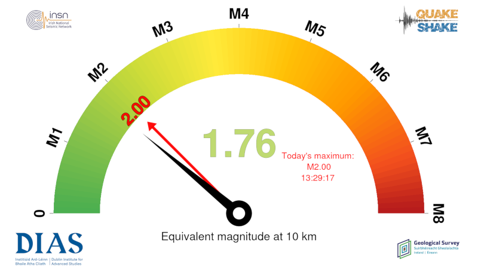
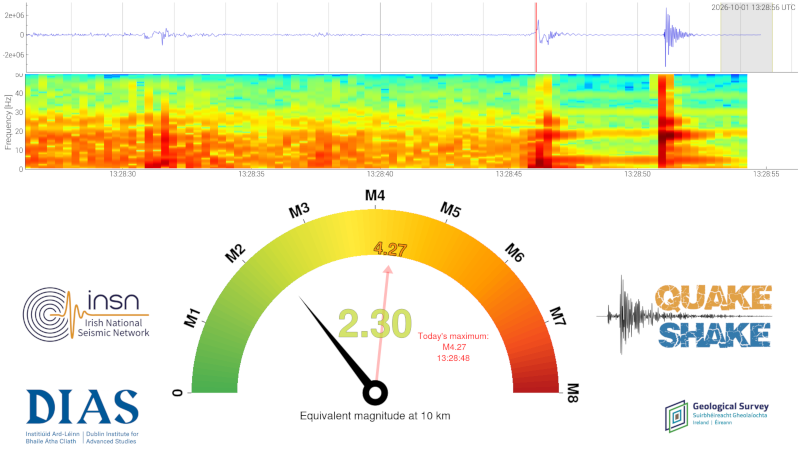

# Shakeometer

A real-time magnitude display for seismology outreach.

Shakeometer reads a live seismogram from a SeedLink server and shows
the local magnitude of the ground motion on a large, speedometer-style
gauge. Jump up and down next to a seismometer and watch the needle
move!

It has two display modes:

1. **Gauge** – the magnitude gauge on its own.
2. **Combo** (`--combo_plot`) – the gauge under a live waveform and
   spectrogram.

It runs on an ordinary laptop/desktop, or directly on a
[Raspberry Shake](https://raspberryshake.org) plugged into a monitor,
which makes a self-contained outreach display with no extra computer
or network setup.

---
| Gauge | Combo |
|---|---|
|  |  |


## What's on the gauge

- **Centre number and needle**: the current magnitude, measured over the
  last few seconds of data.
- **Red arrow**: the largest recent magnitude. It fades out over
  `--max_mag_keep_time` seconds unless something bigger comes along.
- **Today's maximum**: the largest magnitude since the program started
  (resets at midnight UTC), and when it happened.
- **"Equivalent magnitude at *x* km"**: the magnitude is calculated
  *as if* the source were `--magnitude_distance` km from the
  seismometer (see [How the magnitude is calculated](#how-the-magnitude-is-calculated)).

In combo mode, with `--amp_marker`, the waveform panel also shows the
measurement window (grey) and the time of the recent maximum (vertical red line).

---

## Files

| File | Purpose |
|---|---|
| `shakeometer.py` | Main program: options, SeedLink connection, window layout, update loop |
| `gauge.py` | The gauge widget |
| `waveform.py` | Waveform panel (combo mode) |
| `spectrogram.py` | Spectrogram panel (combo mode) |
| `logos.py` | Logo placement |
| `amps.py` | Instrument response removal, Wood-Anderson simulation, amplitude and magnitude |
| `run_gauge_shake.sh`, `run_combo_shake.sh` | Example scripts for a Raspberry Shake (local SeedLink server) |
| `run_gauge_EI-DSB.sh`, `run_combo_EI-DSB.sh` | Example scripts for INSN station EI.DSB via the public EarthScope seedlink server |
| `run_gauge_shake_windows.bat`, `run_combo_shake_windows.bat` | Example scripts for a Windows laptop connected to a Raspberry Shake |
| `EI.DSB.xml` | StationXML (instrument response) for EI.DSB, used by the EI-DSB scripts |
| `desktop/*.desktop` | example Desktop shortcuts for a Raspberry Shake |
| `logos/` | Logos used by the example scripts |
| `shakeometer.png and shakeometer.ico` | Window and desktop-shortcut icons |
| `requirements.txt` | Python packages (desktop/laptop install) |

---

## Requirements

- Python 3.7 or newer
- [ObsPy](https://www.obspy.org) (brings numpy, scipy and matplotlib with it)
- PyQt5
- pyqtgraph
- A desktop/graphical environment to display the window. On a Raspberry
  Shake this means installing a desktop environment on it; how to do that is beyond
  the scope of this project, although the code was tested using the `raspberrypi-ui-mods` package. 

### Desktop or laptop

```bash
pip install -r requirements.txt
```

On Windows, install Python from [python.org](https://www.python.org)
(tick "Add python.exe to PATH" in the installer), then in a command
prompt in the shakeometer folder:

```bat
python -m pip install -r requirements.txt
```

### Raspberry Shake / Raspberry Pi

The Raspberry Shake OS (Raspbian Buster) comes with Python 3.7 and
ObsPy can be installed with pip. The specific package versions tested and confirmed to work are shown below. PyQt5 has no pip wheel for the Pi, so
install it from apt, and pin pyqtgraph to a version that works with the
Qt 5.11 that apt provides (pyqtgraph 0.12 and later need Qt 5.12+):

```bash
sudo apt install python3-pyqt5 python3-pip libatlas-base-dev
python3 -m pip install --upgrade pip
python3 -m pip install matplotlib==3.5.3 numpy==1.21.4 obspy --only-binary :all:
python3 -m pip install "pyqtgraph==0.11.1"
```

(On newer Raspberry Pi OS releases, pip may refuse with an
"externally-managed-environment" error; use a virtual environment, or
add `--break-system-packages`.)

**Turn on the Pi's graphics acceleration.** Without it, Qt draws
everything on the CPU and the display struggles, especially at higher
screen resolutions. Run `sudo raspi-config`, go to
*Advanced Options → GL Driver → G3 GL (Full KMS)*, and reboot. (A
`libEGL warning: DRI2: failed to authenticate` message in the terminal
when shakeometer starts is a sign it's off.)

---

## Instrument response (StationXML)

The magnitude calculation needs the seismometer's instrument response,
given as a StationXML file with `--inventory`.

- **EI.DSB**: included (`EI.DSB.xml`).
- **A Raspberry Shake**: download it from the Raspberry Shake FDSN
  service, replacing `RXXXX` with your station code:

  ```bash
  curl -o AM.RXXXX.xml "https://data.raspberryshake.org/fdsnws/station/1/query?network=AM&station=RXXXX&level=response&format=xml"
  ```

  The Shake scripts expect it as `AM.<station code>.xml` in the
  shakeometer folder.
- **Other stations**: most public networks can be downloaded from the
  EarthScope FDSN service, e.g.
  `https://service.iris.edu/fdsnws/station/1/query?net=EI&sta=DSB&level=response&format=xml`.

---

## Quick start

From the shakeometer folder:

```bash
./run_gauge_EI-DSB.sh     # gauge, INSN station DSB (Dublin) – works from anywhere
./run_combo_EI-DSB.sh     # combo, same station
```

On a Raspberry Shake, first edit `SHAKE="..."` at the top of the Shake
scripts to your station code and download its StationXML (above), then:

```bash
./run_gauge_shake.sh
./run_combo_shake.sh
```

Or run `shakeometer.py` directly, e.g.:

```bash
python3 shakeometer.py \
    --seedlink_server rtserve.earthscope.org \
    -s "EI_DSB:HHZ" \
    -b 1m \
    --inventory EI.DSB.xml \
    --magnitude_distance 100 \
    --combo_plot
```

### Windows laptop connected to a Raspberry Shake

Useful when the Shake has no screen of its own: connect the laptop
directly to the Shake with an ethernet cable and run shakeometer on the
laptop, reading from the Shake's SeedLink server.

1. Download the Shake's StationXML (see above) into the shakeometer
   folder while you still have internet.
2. At the top of `run_gauge_shake_windows.bat` and
   `run_combo_shake_windows.bat`, set `SHAKE` to your station code and
   `SHAKE_IP` to the Shake's address.
   - Try `rs.local` first (the default). `ping -4 rs.local` in a
     command prompt tells you if the laptop can find it.
   - If not, use the Shake's IP address. With a direct cable and no
     router, the Shake and laptop give themselves `169.254.x.x`
     addresses after a minute or so; run `arp -a` and look under the
     ethernet adapter for the Shake's `169.254.x.x` entry.
3. Double-click the `.bat` file.

A laptop has far more power than the Shake's Pi, so these scripts use
faster update rates and a finer spectrogram than the Shake scripts.

All the example scripts assume they are run from the shakeometer
folder (for the logo and StationXML paths). The Windows scripts change
to their own folder automatically. Remove the `--logo_*` lines
if you don't want logos, or point them at your own images.

### Keyboard shortcuts

| Key | Action |
|---|---|
| `f` | Toggle fullscreen |
| `q` / `Esc` | Quit |

---

## Desktop shortcuts (Raspberry Shake)

`desktop/` has two shortcuts that open a terminal and start the gauge
or combo Shake script. They assume shakeometer is installed in
`/home/myshake/Software/shakeometer` (the Shake's default user is
`myshake`); edit the paths inside them if not. Then:

```bash
cp desktop/*.desktop ~/Desktop/
chmod +x ~/Desktop/shakeometer_*.desktop run_*.sh
```

---

## Running on a Raspberry Pi: performance

On a Pi the display is limited by CPU, and the settings in the Shake
scripts are tuned for it. Things worth knowing:

- **`--update_time` below what the Pi can manage doesn't make it
  faster.** The next update just starts as soon as the last one
  finishes, with the CPU at 100%. The Pi is also running the Shake's
  own data acquisition and SeedLink server, and can get hot and
  throttle itself over a long event. Set `--update_time` just above
  what the Pi actually achieves. On the Raspberry Shake used for
  testing, at 1600×900, that was about 0.08 s for the gauge and 0.14 s
  for combo mode, hence 0.09 s and 0.15 s in the scripts.
- **Screen resolution matters**: everything on screen is redrawn on
  every update. 1920×1080 was too much for the Pi used in testing;
  1600×900 and 1280×720 worked.
- **The spectrogram is the most expensive part of combo mode.** A
  shorter window (`--spec_wlen`) and less overlap (`--spec_overlap`)
  make it much cheaper, at the cost of a blockier look;
  `--spec_update_time` sets how often it is recalculated.

On a laptop or desktop none of this applies; much faster update rates
should work fine.

---

## How the magnitude is calculated

Every update, shakeometer takes the last `--magnitude_window` seconds
of data (default 2 s), ending `--seedlink_wait_buffer` seconds before
now to allow for data latency, and:

1. removes the instrument response (poles and zeros from the StationXML),
2. simulates a Wood-Anderson seismograph,
3. measures the largest peak-to-trough amplitude,
4. converts it to a local magnitude with the Hutton & Boore (1987)
   attenuation relation for a distance of `--magnitude_distance` km.

Because the real distance to the "source" (a jumping person, a passing
lorry, an earthquake) isn't known, the result is the magnitude an event
*would* have if it produced this shaking at the chosen distance – hence
"Equivalent magnitude at *x* km". For outreach with a local Shake, 10 km
gives sensible numbers for nearby activity; for a broadband station
watching regional earthquakes, a larger distance (the EI-DSB scripts use
100 km) is more appropriate. Negative magnitudes are shown as 0 unless
`--allow_negative_mags` is given.

---

## Command-line options

Run `python3 shakeometer.py --help` for the full list with defaults.

### Connection

| Option | Default | Description |
|---|---|---|
| `--seedlink_server HOST[:PORT]` | *(required)* | SeedLink server; port defaults to 18000. `localhost` on a Raspberry Shake |
| `-s`, `--seedlink_streams` | *(required)* | Stream, `NET_STA:LOCCHA`, e.g. `EI_DSB:HHZ` or `AM_RDF52:00EHZ` |
| `-b`, `--backtrace_time` | *(required)* | Length of data to keep and plot (`s`/`m`/`h`/`d` suffixes allowed) |
| `--seedlink_wait_buffer SEC` | `4` | How far behind real time the magnitude window ends, to allow for latency |

### Display

| Option | Default | Description |
|---|---|---|
| `--combo_plot` | off | Waveform + spectrogram + gauge, instead of the gauge alone |
| `--update_time SEC` | `0.1` | Time between display updates |
| `--amp_marker` | off | (Combo) shade the measurement window and mark the recent maximum on the waveform |
| `-f`, `--fullscreen` | off | Start fullscreen |
| `--x_size`, `--y_size` | 900×550 (gauge), 1800×1100 (combo) | Window size in pixels |
| `--x_position`, `--y_position` | `0` | Window position in pixels |
| `--without-decoration` | off | No window title bar or borders (asks for confirmation unless `--force`) |
| `-v`, `--verbose` | off | Debug output in the terminal |

### Magnitude

| Option | Default | Description |
|---|---|---|
| `--inventory FILE` | *(required)* | StationXML file with the instrument response |
| `--magnitude_window SEC` | `2` | Length of data used for each magnitude measurement |
| `--magnitude_distance KM` | `10` | Distance the magnitude is calculated for |
| `--maximum_magnitude M` | `8` | Maximum value for the gauge scale |
| `--max_mag_keep_time SEC` | `30` | How long the recent-maximum arrow takes to fade |
| `--allow_negative_mags` | off | Show negative magnitudes instead of truncating to 0 |

### Logos

Each takes a PNG/JPG file.

| Option | Gauge mode | Combo mode |
|---|---|---|
| `--logo_topleft` | top-left corner | left of the gauge |
| `--logo_topright` | top-right corner | right of the gauge |
| `--logo_bottomleft` | bottom-left corner | bottom-left corner |
| `--logo_bottomright` | bottom-right corner | bottom-right corner |

### Waveform and spectrogram (combo mode)

| Option | Default | Description |
|---|---|---|
| `--spec_update_time SEC` | `1` | Time between spectrogram updates (the waveform and gauge still update every `--update_time`) |
| `--spec_bandpass FMIN FMAX` | off | Bandpass filter (Hz) for the waveform and spectrogram. The magnitude always uses unfiltered data |
| `--spec_wlen SEC` | `2.56` | FFT window length |
| `--spec_overlap PCT` | `85` | FFT window overlap, percent |
| `--spec_colorscale` | `fixed` | `fixed`: colour scale from `--spec_vmin` to `--spec_vmax` (dB). `auto`: rescaled to each frame |
| `--spec_vmin`, `--spec_vmax` | `0`, `50` | Colour scale limits in dB, for `fixed` |

---

## Fonts

The gauge uses the first of these that is installed: Nimbus Sans,
Liberation Sans, Arial, DejaVu Sans. On Debian/Raspberry Pi OS,
`sudo apt install fonts-urw-base35` (Nimbus Sans) or
`sudo apt install fonts-liberation` gives the cleanest look.

## References
Hutton, L. K., and D. M. Boore. 1987. The M<sub>L</sub> Scale in Southern California. Bulletin of the Seismological Society of America 77 (6): 2074–94.

## Release History
* 0.0.1
    * First release. Work in progress
* 0.0.2
* * Tagged release for Github

## Licensing

Copyright (c) 2026, Patrick Smith and all persons listed in [CONTRIBUTORS.md](https://git.dias.ie/paddy/shakeometer/-/blob/main/CONTRIBUTORS.md). This project is licensed under the EUPL, v1.2. See [LICENSE.txt](https://git.dias.ie/paddy/shakeometer/-/blob/main/LICENCE.txt) for more information.

## Meta
 Patrick Smith – Patrick.Smith@dias.ie

[](https://www.dias.ie/)
[](https://www.insn.ie/)
[](https://www.quakeshake.ie/)

[https://git.dias.ie/paddy/shakeometer](https://git.dias.ie/paddy/shakeometer)

## Cite this code
[](https://doi.org/10.5281/zenodo.23570435)


